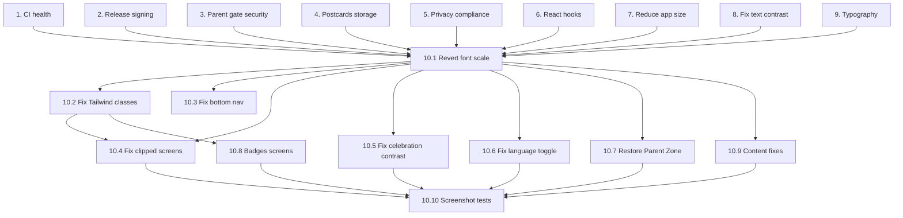

# Implementation Plan

## Overview

Play Store Release Readiness implementation plan covering CI health, security, compliance, UI fixes, and comprehensive testing to ensure the app is ready for submission.

## Notes

### Global rules (apply to every task)
- Run ONE task at a time and stop when it is done. Do not start the next task.
- Never print, log or commit secrets (keystore, passwords, API keys).
- Change only what the task lists. No refactors, restyling or new features.
- No any, as any, @ts-ignore or eslint-disable to make errors disappear.
- Do not add any Android permission.
- After each task run what its VERIFY line says and report: files changed, files deleted, anything unsure.
- Do not create summary .md / .txt files in the repo root.

## Tasks
 1. CI health: lockfile, test config, types
 2. Release signing and repo hygiene
 3. Parent gate and PIN security
 4. Postcards without storage permission
 5. Privacy and Families compliance cleanup
 6. Fix React hooks violations
 7. Reduce app size
 8. Fix invisible text (text-muted) and add a contrast test
 9. Kid-friendly typography and less text on Journey and Explore
 10. Stabilize layout and restore missing pieces after tasks 8-9
Context: after tasks 8 and 9 many screens are broken (Home header squashed, Learning Hub clipped, quiz buttons hidden under the bottom nav, unreadable text on celebration screens). Do sub-tasks 10.1 to 10.9 in order, one commit each.
 10.1 Revert the global font scale
In src/styles.css (~line 171) change html { font-size: 112.5% } back to 100%. Rem units scale ALL spacing, icons and radii, and the screens are fixed-height with overflow-hidden, so the extra 12.5% overflowed everywhere.
Keep larger text only through the type tokens (body and labels 16-18px, titles 22-28px) applied to text classes, not to the root.
VERIFY: npm run build; Home, Journey and the Learning Hub fit at 360x800 with no clipped content.
 10.2 Fix the 272 inert Tailwind classes
Classes like gap-[--gap-base], p-[--padding-md], mt-[--space-0-25], px-[--padding-lg] are Tailwind v3 syntax and generate NO CSS in Tailwind v4 (verified in the compiled CSS). Padding, gaps and margins are silently missing in ParentZone, HomeScreen, GranularConsentDialog, ResetPINDialog, LanguageToggle and more.
Codemod: regex ([a-z-]+)-\[(--[a-z0-9-]+)\] becomes $1-($2).
Add a CI check that fails if grep -rE "[a-z]-\[--" src finds anything.
Review every touched screen afterwards: spacing that was missing will now appear.
VERIFY: grep finds nothing; npm run build passes; the compiled CSS contains the new classes.
Depends on: 10.1
 10.3 Fix the bottom navigation
It renders on every route from src/routes/__root.tsx (~line 455), so on quiz questions, learning cards and celebrations it covers the primary button and content shows through the gap below the pill.
Hide the nav on immersive routes: quiz, learning cards, state celebration, and any full-screen modal.
Give the nav wrapper a solid page-coloured background that includes the safe-area inset.
Replace the fixed pb-[80px] on <main> with a --nav-h CSS variable measured from the real nav height plus env(safe-area-inset-bottom).
VERIFY: on every screen with the nav, the last element is fully visible and scrollable; on quiz screens the Check / Next button is fully visible.
Depends on: 10.1
 10.4 Fix squashed and clipped screens
Home (src/components/screens.tsx ~762): the root is h-full flex-col overflow-hidden and the header can shrink. Make the content area overflow-y-auto and the header shrink-0.
Learning Hub (state topic grid and the "Quiz Locked" bar): the grid is clipped at the third row. Make it scroll and keep the bar above the nav.
Quiz screen: the "Total XP / +20 per answer" bar runs edge to edge. Give it the same horizontal padding as the rest of the screen.
VERIFY: no clipped content at 360x800 and 411x891.
Depends on: 10.1, 10.2
 10.5 Fix contrast on celebration and modal screens
"STATE COMPLETE" and "Haryana Cleared!" are white on yellow (about 1.3:1). Use ink text on yellow.
"STATE MASTERED" modal: white labels on light-orange tiles and the translucent "Dismiss" button. Use ink on light tiles or solid deep orange behind white text.
Achievement modal: green text on pale green and white "Celebrate!" on yellow. Use dark green or ink.
Confetti must not overlap text or sit above the nav.
Locked badge grid: grey text on grey tiles (about 2.5:1). Darken the text.
Add all of these screens to the axe contrast spec.
VERIFY: axe color-contrast passes on all of them.
 10.6 Fix the language toggle
src/components/LanguageToggle.tsx uses a non-existent class bg-info-soft0 with text-white, so the chip has no background and the white text is invisible.
Replace it with clay-button clay-explorer (ink text). Check the Learning Card top bar shows the active language name clearly.
VERIFY: the chip is readable on the Learning Card screen.
 10.7 Restore access to the Parent Zone
Commits 68b0d26 and 49810fa removed the Help and Parent sections from the Me tab, and nothing links to /parent any more (ParentZonePlaceholder is never rendered). Consent controls, the analytics toggle, data export and reset, and parent sharing are unreachable.
Add a small "For grown-ups" button with a padlock at the bottom of the Me tab that opens /parent through the PIN gate. Do NOT restore the long Help section.
VERIFY: from the Me tab you can reach the PIN prompt, and after the correct PIN the Parent Zone opens.
 10.8 Badges screens and data
The Completed state card (List, Card and Grid views) is only about two thirds of the width, and its star row is clipped at the left edge. Use full-width cards with proper padding (likely fixed by 10.2).
Investigate why a completed state shows "0/9 Badges" and "0/216 Badges" while the celebration says "+3 Badges". Report the cause before changing any logic.
VERIFY: the cards are full width; a written explanation of the badge-count mismatch.
Depends on: 10.2
 10.9 Content and copy fixes
"2.millions of people" typo on the Chandigarh card; Chandigarh is not a state, so remove "Industrial state!".
The learning card shows a generic building emoji with a huge blank area. Use the state's illustration or a smaller emoji with a tighter layout.
Me tab stats show "0" with captions "READY TO START! / TIME TO EXPLORE! / EARN IN QUIZZES!" that do not say what is counted. Use clear labels (States, Badges, XP).
Journey and Explore still show the duplicate heading "Northern Region / 0 of 6 explored" under the region bar. Remove it.
Home milestone row: show only 5, 10, 15 ... 36 without the word "States" so labels do not collide.
Make state grid cards equal height so their tops align.
VERIFY: visual check of Home, Journey, Explore, Me and the Learning Card.
 10.10 Screenshot test for every screen
Add a Playwright spec tests/e2e/screens.spec.ts that opens Home, Journey, Explore, a state hub, a learning card, a quiz question, the celebration, Badges (both tabs, all 3 views), Me and the Parent gate at 360x800 and 411x891, also at a 1.3 font scale.
Fail on horizontal scroll, on any element overlapping the bottom nav, and on axe color-contrast violations. Save screenshots.
VERIFY: npm run build and npm run test pass; screenshots are saved.
Depends on: 10.1 to 10.9

 11. Fix quiz progress, state completion and celebration flow
Context: a state is only marked complete when the StateCompletedScreen component mounts after the quiz (src/components/screens.tsx ~3366). Quiz progress (question index, correct count) is React state only, so closing the app mid-quiz loses it. recordStatePerformance is never called because src/routes/state.$slug.complete.tsx does not pass quizMetrics, so performance badges never increase. Do the sub-tasks in order, one commit each.
 11.0 STOP THE PROGRESS WIPE (do this first, before anything else)
Root cause (verified by running the app's own validator): ProgressSchema in src/lib/localStorage-schema.ts requires avatar: z.string().emoji(), but the app saves avatar IDs like explorer-hat, turban-red. On the next launch validateProgress fails and hydrate() in src/lib/progress.ts deletes the saved progress and starts from defaults, so cards, XP, quiz XP and completed states are all lost after the app is closed. Everything looks fine inside one session.
Fix the schema: avatar: z.string().min(1).max(40).optional().
A second landmine: statePerformance in the schema expects { state, cardIndex, category, timeTaken, isReplay, timestamp } but recordStatePerformance saves { timeToComplete, quizScore, earnedPerformanceBadges, ... }. Make the schema match StatePerformanceMetrics in src/lib/state-performance-badges.ts, or saving performance badges will wipe the progress on the next launch.
Never delete data because validation failed. On failure, copy the raw value to india-explorer:progress:v2:backup (keep the last one), then salvage every field that validates (use per-field safeParse) and only default the fields that fail.
Add a round-trip test: for every avatar ID in src/lib/avatar-config.ts and for a progress object produced by real calls (saveProfile, markCard, markCardVisit, addXP, completeState, recordStatePerformance), validateProgress(JSON.parse(localStorage...)) must succeed. Add the same style of test for the other schemas (consent, recently completed, postcard library).
VERIFY: choose an image avatar, read cards, answer a quiz question, fully close and reopen the app: everything is still there. Test with -Install, never -Reinstall (that erases app data on purpose).
 11.1 Persist in-progress quiz state
Add quiz-progress storage (key india-explorer:quiz-progress:v1, validated with Zod in src/lib/localStorage-schema.ts), per state: { index, correctCount, answers: [{ id, correct }], startedAt, updatedAt }. Save after every Check and every Next. Never send it to analytics.
On QuizScreen mount, resume at the saved question. Clear it when the quiz finishes. Expire entries after 7 days.
VERIFY: unit tests for save, resume, clear and expiry; answer 2 questions, reload the page, and the quiz resumes at question 3.
 11.2 One atomic completion function
Add finishQuiz(stateName, metrics) in src/lib/progress.ts that, in a SINGLE set(), completes the state (XP, stamp, postcard data), records performance badges via recordStatePerformance, and queues a pending celebration. Call it from QuizScreen when the last answer is confirmed, before navigating.
Make StateCompletedScreen display-only: remove completeState, recordStatePerformance and markRecentlyCompleted from its useEffect.
Remove the require("@/store/postcard-library-store") and require("@/lib/progress") calls in StateCompletedScreen (ESM build: require is not defined). Use normal imports.
The postcard code there creates a 900x1200 canvas and never draws on it, so a BLANK PNG is saved to the library on every completion. Remove it, or render the real postcard.
VERIFY: kill the app between the last answer and the celebration screen; on reopening the state is still completed and the badges are recorded.
Depends on: 11.1
 11.3 Fix quiz score maths
onReset in QuizScreen (~line 3095) computes (correctCount + 1) / questions.length. correctCount already includes the last correct answer, so the score is always inflated by one question (up to 114%). Compute the score from the stored answers. Track real quizAttempts per state (it is hard-coded to 1).
VERIFY: unit tests for all-correct, all-wrong and last-answer-wrong.
Depends on: 11.1
 11.4 Replace the Home "State Mastered" popup
The popup (screens.tsx ~560-690) uses a 5-minute localStorage marker, auto-dismisses after 3 seconds, shows typed-in values (+250 XP, +3 badges), and calls hooks after an early return (the react-hooks errors at lines 580 and 588, which can crash Home).
Replace it with a persistent pending-celebration queue stored in progress: it stays until the child taps a button (no auto-dismiss, no expiry), shows the real XP and badges awarded, and is shown once.
Fix the hooks-order errors.
VERIFY: complete a state, wait more than 5 minutes, open Home: the popup is still there until dismissed, then never shows again.
Depends on: 11.2
 11.5 Guard the completion route and the flow after the 6th card
/state/$slug/complete must redirect to the learning hub when the state is not completed.
After the 6th card, do not jump silently into the quiz. Show a big friendly screen: "All 6 cards done! Start quiz / Later". "Later" returns to the hub with a pulsing "Take the Quiz!" button.
From the completion screen, the Android back button goes to the hub, not back into the finished quiz.
VERIFY: manual test of both paths (start quiz now, and later).
Depends on: 11.2
 11.6 Stop wiping all data on a version change
hydrate() in src/lib/progress.ts calls localStorage.clear() when APP_VERSION changes, which would erase progress, consent and the parent PIN. Replace it with migrations that keep data.
VERIFY: a unit test that changes the version and keeps progress.
 11.7 End-to-end test
Playwright: read 6 cards, see the "Start quiz / Later" screen, start the quiz, answer 2 questions, reload, resume at question 3, finish, see the celebration, check that the state is completed, the State Badges count increased, and the Home popup shows once.
VERIFY: npm run build and npm run test pass.
Depends on: 11.1 to 11.6
 11.8 Rewards and postcard flow (the agreed behaviour)
Card seen: counts when the child taps Next past it; saved immediately; progress bars move; no XP per card.
Category (6 per state): complete when all its cards were seen; +25 XP once, a checkmark and a small celebration; saved immediately; reopening resumes at the first unseen card.
Quiz unlocks at 6/6 categories (the "Start quiz / Later" screen from 11.5). Each answer: +20 XP the first time a question is answered correctly; a wrong answer shows the right one with no penalty; saved after every answer.
Quiz finished (all questions answered, any score): ONE atomic save of: state completed, +100 XP bonus, stamp, postcard data, 1 to 3 stars (6 or more right = 3 stars, 4 or more = 2 stars, otherwise 1 star), performance badges. Nobody gets stuck on a low score. The quiz can be replayed from the hub; the best stars are kept; no XP is repeated.
Postcard: created at completion, rendered for real (state illustration, name, stamp, date, stars), never a blank image. Flow: Celebration, then Postcard reveal (automatic, not a hidden secondary button), then Next State. It is saved in the Passport. If the app closes before it is seen, it appears at the next launch. Sharing stays behind the parent gate.
The "Save Postcard" and "Next State" buttons on the celebration screen are currently hidden under the bottom nav; hide the nav there.
Home popup: from 11.4; shows the real XP, stars and badges.
VERIFY: a unit test per rule above; Playwright flow from the first card to the postcard reveal with a reload in the middle.
Depends on: 11.0 to 11.5

## Task Dependency Graph

